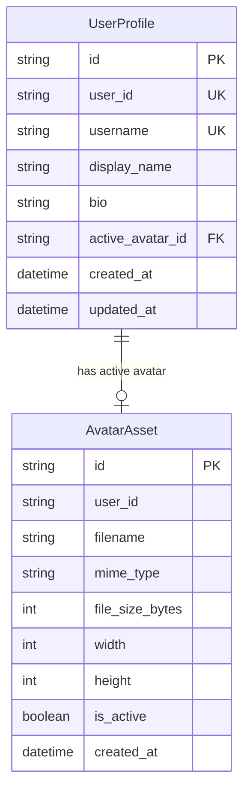
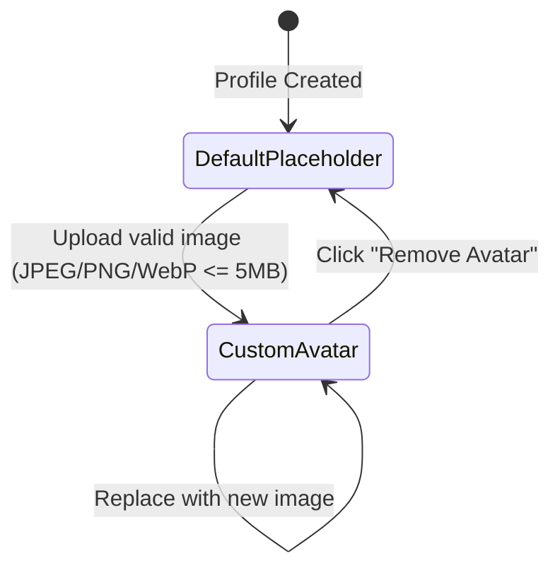

# Phase 1 Data Model: User Profile & Avatar System

**Feature**: `001-user-profile` | **Date**: 2026-11-16

This document specifies the data entities, field constraints, relationships, and lifecycle states for the user profile feature.

---

## 1. Entities

### Entity: `UserProfile`
Represents the account holder's public and editable persona.

| Field Name | Type | Nullable | Default | Description & Validation Rules |
| :--- | :--- | :--- | :--- | :--- |
| `id` | `UUID / String(36)` | No | Auto-generated | Primary key unique identifier. |
| `user_id` | `String(64)` | No | — | Foreign reference / unique identifier of the authenticated user. Unique index. |
| `username` | `String(32)` | No | — | Alphanumeric handle (3-32 chars, `^[a-zA-Z0-9_.-]+$`). Unique index. |
| `display_name` | `String(64)` | No | — | Human-readable name (1-64 chars, sanitized UTF-8). |
| `bio` | `String(500)` | Yes | `""` | User biography text (0-500 characters, whitespace trimmed, max 2 consecutive line breaks). |
| `active_avatar_id`| `UUID / String(36)` | Yes | `None` | Foreign key referencing `AvatarAsset.id`. Null when using default placeholder. |
| `created_at` | `DateTime (UTC)` | No | `utcnow()` | Timestamp when profile was initialized. |
| `updated_at` | `DateTime (UTC)` | No | `utcnow()` | Timestamp of last modification. |

### Entity: `AvatarAsset`
Represents uploaded avatar image files and their storage references.

| Field Name | Type | Nullable | Default | Description & Validation Rules |
| :--- | :--- | :--- | :--- | :--- |
| `id` | `UUID / String(36)` | No | Auto-generated | Primary key unique identifier. |
| `user_id` | `String(64)` | No | — | Owner user ID. Indexed. |
| `filename` | `String(128)` | No | — | Storage filename on disk (e.g., `<id>.webp`). |
| `mime_type` | `String(32)` | No | `"image/webp"` | MIME type of processed image. |
| `file_size_bytes` | `Integer` | No | — | File size on disk in bytes (typically 10KB - 40KB post-processing). |
| `width` | `Integer` | No | `256` | Image width in pixels. |
| `height` | `Integer` | No | `256` | Image height in pixels. |
| `is_active` | `Boolean` | No | `True` | Whether this is the currently active avatar for the user. |
| `created_at` | `DateTime (UTC)` | No | `utcnow()` | Upload timestamp. |

---

## 2. Entity Relationships

- **One-to-One (Active)**: Each `UserProfile` references at most one active `AvatarAsset` (`active_avatar_id`).
- **One-to-Many (Historical)**: A user can upload multiple avatars over time; previous avatars are marked `is_active = False` or cleaned up upon replacement.

---

## 3. Avatar State Transitions

1. **DefaultPlaceholder**: `active_avatar_id` is `None`. The client or API serves a standardized deterministic placeholder (e.g. SVG initials avatar).
2. **Upload New Image**:
   - Validation: File size <= 5MB, format in `image/jpeg`, `image/png`, `image/webp`.
   - Processing: Strip EXIF, resize to 256x256, convert to WebP.
   - Storage: Write to `uploads/avatars/<id>.webp`.
   - Record created in `AvatarAsset` with `is_active = True`.
   - `UserProfile.active_avatar_id` updated to new `<id>`.
   - Old avatar assets archived or marked inactive.
3. **Remove Avatar**:
   - `UserProfile.active_avatar_id` set to `None`.
   - Active `AvatarAsset` marked `is_active = False`.

---

## 4. Validation Rules Summary

- **Display Name**: Mandatory, 1 to 64 characters. Strips leading/trailing whitespace.
- **Bio**: Optional, 0 to 500 characters. Strips leading/trailing whitespace.
- **Avatar File Input**: Max 5,242,880 bytes (5MB). Allowed MIME: `image/jpeg`, `image/png`, `image/webp`.
- **Avatar Output**: Exactly 256x256 WebP format.
